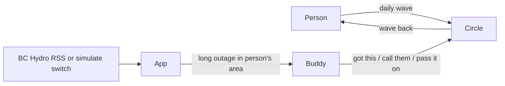

# Architecture

Keep this current. Update it when the design changes.

## One-line pitch
Wave to your people every day. When the power goes out, the same circle knows who to check on.

## Product: Daily Wave plus outage layer
- **The wave:** open the app and one large target sits under the thumb. One tap, done. A shared postcard grows as the reward. No feed, no tour, no settings before the first wave.
- **Circle and reciprocity:** everyone waves and is waved at. Roles (person, buddy) appear only during an outage, and only because the person chose them.
- **Person controls everything:** they pick buddies, the trigger (long outage in their area) and quiet hours. Pausing or leaving a circle needs no explanation and sends only a neutral "paused". Nobody can enrol a person at risk.
- **Outage alert:** the buddy sees one screen with three choices: "I've got this", "Call them instead", "Can't, pass it on". Pass-on notifies the rest of the circle. No guilt copy.
- **Quiet-nudge:** gentle prompt when someone goes quiet. Cuttable.
- **Accessibility:** large targets, high contrast, screen-reader labels, no colour-only state, reduced-motion option for the postcard.
- Collect equipment categories only (breathing equipment, refrigerated medication, mobility equipment), never specific conditions or medications.

## Outage source
BC Hydro regional and municipal RSS feed (15 minute cadence, area level). Parse fixture-first inside a 2-hour box. A clearly labelled simulate switch drives the demo. Show last-checked time. The undocumented map JSON is not relied on.

## Honesty rules (say aloud and show on screen)
- Research is desk-based from public sources.
- The circle in the demo is seeded and labelled as such.
- The feed is unofficial and may be delayed.
- Slide: this supplements emergency services and the person's own backup power plan.

## Stack
- Frontend: TODO
- Backend: TODO
- Auth: Auth0 (passwordless login, invitations)
- Hosting: TODO. Must be a public URL so two real phones can open it.
- Live updates: in-app live updates or polling. Avoid native push in 24 hours.
- Gemini: optional tool only, not an opt-in

## Diagram

## Demo order
Quiet Tuesday (waves, postcard fills) -> person sets buddies, trigger, quiet hours, including pause -> outage turns the postcard urgent -> buddy alert, one-tap confirm, show pass-on -> roadmap slide (heat, chains) -> honest limits.

## Who owns what
- Assign: backend and data / frontend and design / research and pitch.
