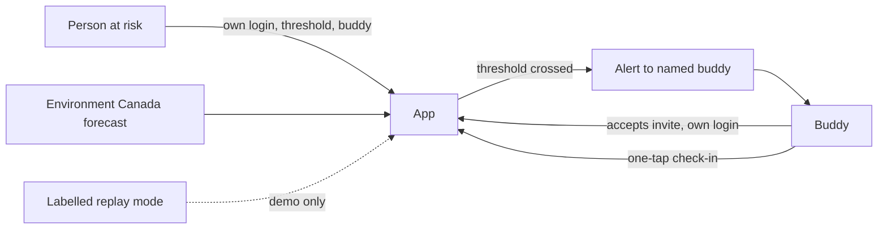

# Architecture

Keep this current. Update it when the design changes.

## One-line pitch
When the forecast turns dangerous, a named neighbour knows to knock, and the person at risk decides who that is.

## Product: heat-wave buddy network
- The person at risk signs up themselves, sets their own heat threshold, names their own buddy, picks one alert channel, and can revoke in one tap.
- Hard rule: nobody can enrol a person at risk. Others may share an invitation. Only the person accepts it, from their own login. A buddy is added only by the person's choice and with the buddy's acceptance.
- When the forecast crosses the person's threshold, their buddy is alerted. The buddy checks in with one tap. The person can tap "I'm okay".
- No automatic contact with strangers or agencies.
- Not an emergency or safety service. Say so in the app and the pitch.

## Scope order (cut from the bottom)
1. One role (person at risk) with Auth0 login, threshold, and buddy.
2. Live Environment Canada forecast for one station, one threshold.
3. Threshold fires, buddy is alerted, one-tap check-in. This loop is the demo.
4. Second role (buddy) with its own login.
5. Labelled replay mode using the 2021 heat dome forecast.
6. Escalation, extra polish. Likely cut.

## Stack
- Frontend: TODO
- Backend: TODO
- Database / auth: Auth0 (passwordless login, role-based access for person vs buddy)
- Hosting: TODO
- Data / APIs: Environment Canada forecast data. Gemini only as a tool for plain-language alert wording, not an opt-in.

## Diagram

## Hour-8 gate (both must be yes)
1. At least three real conversations done, and one finding changed the consent flow. Consent flow checked with a real person.
2. A threshold fires from LIVE data, reaches a named buddy, and is confirmed with one tap, with Auth0 login working for one role.
If not, switch to the fallback: flood watch from public river-gauge data with Tiger Data.

## Who owns what
- Name: hardware is out. Assign: backend and data / frontend and Auth0 / research and pitch.
