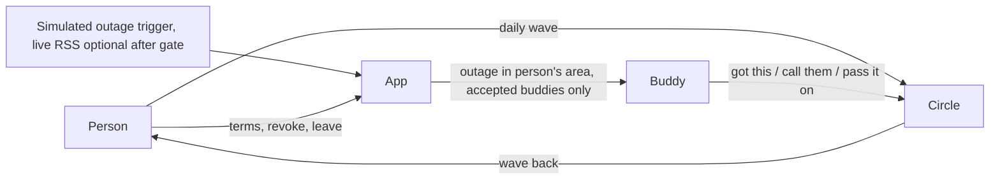

# Architecture

Keep this current. Update it when the design changes.

## One-line pitch
Wave to your people every day. When the power goes out, the same circle knows who to check on.

## Product: Daily Wave plus outage layer
- **The wave:** open the app and one large target sits under the thumb. One tap, done. A shared postcard grows as the reward. No feed, no tour, no settings before the first wave.
- **Postcard floor:** a shared image or grid that adds one element per wave, plus a counter. Anything richer is spare-time work.
- **Circle and reciprocity:** everyone waves and is waved at. Roles (person, buddy) appear only during an outage, and only because the person chose them.
- **Person controls everything:** they pick buddies, the trigger (long outage in their area) and quiet hours. Pausing or leaving a circle needs no explanation and sends only a neutral "paused". Nobody can enrol a person at risk.
- **Circle terms screen (never cut):** per buddy, the person sees exactly what that buddy can see and can revoke or leave at any time, effective immediately. The buddy sees only: an outage was reported in the person's area, the data time, and last wave. Nothing else. Alerts and details never reach a buddy who has not accepted the invite.
- **Outage alert:** the buddy sees one screen with three choices: "I've got this", "Call them instead", "Can't, pass it on". Pass-on notifies the rest of the circle. No guilt copy. The alert carries static provenance text: source, data time, why you got this.
- **Quiet-nudge:** gentle prompt when someone goes quiet. Cuttable.
- **After the build gate only:** plain activity list, "looks wrong" flag on an alert, offline wave queue. All cuttable.
- **Accessibility:** large targets, high contrast, screen-reader labels, no colour-only state, reduced-motion option for the postcard.
- Collect equipment categories only (breathing equipment, refrigerated medication, mobility equipment), never specific conditions or medications.

## Outage source
The trigger sits behind one interface and is simulated by default from the start, with a clearly labelled "Simulate outage" control. The pitch says "simulated".

Live BC Hydro regional and municipal RSS feed (15 minute cadence, area level) is not started before the hour-8 gate. After the gate it is an optional 2-hour box, fixture-first, swapped in only if it works. Show last-checked time if live. The undocumented map JSON is not relied on.

## Honesty rules (say aloud and show on screen)
- Research is desk-based from public sources. The circle's terms are hypotheses to test with real users, not findings.
- The circle in the demo is seeded and labelled as such.
- The trigger in the demo is simulated. The real feed is unofficial and may be delayed.
- "Can't, pass it on" exists because the buddy is free to refuse.
- Slide: this supplements emergency services and the person's own backup power plan.

## Stack
- Frontend: TODO
- Backend: TODO
- Auth: Auth0 (passwordless login, invitations)
- Hosting: TODO. Must be a public URL so two real phones can open it.
- Live updates: in-app live updates or polling. Avoid native push in 24 hours.
- Gemini: optional tool only (weekly postcard caption, first thing cut), not an opt-in

## Diagram

## Demo order
Quiet Tuesday (waves, postcard fills) -> person sets buddies, trigger, quiet hours, sees and edits circle terms, including pause -> simulated outage turns the postcard urgent -> buddy alert with provenance, one-tap confirm, show pass-on -> roadmap slide (heat, chains) -> honest limits.

## Who owns what
- Assign: backend and data / frontend and design / research and pitch.
