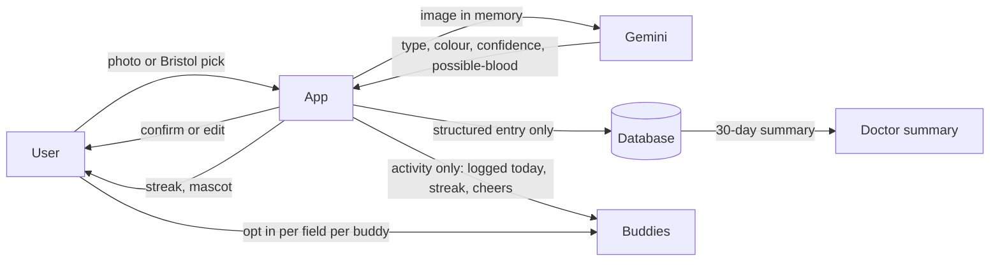

# Architecture

Keep this current. Update it when the design changes.

## One-line pitch
Log your poop in five seconds, let an AI read the photo, keep a streak with a few friends, and walk into the doctor's office with a record.

## Mission (decided 2026-11-08)
Destigmatize poo. The product wedge is permission to talk about it, not a better stool classifier; Gemini is the tool, not the idea. Never claim the app prevents cancer or that we measured destigmatization.
- **Pitch spine (4 min):** 0:00 live hand raise ("raise your hand if you pooped today", then "keep it up if you'd tell a friend"); 0:30 the problem with two sourced stats and an out-loud "surveys, not proof"; 1:15 live demo with Play-Doh or an illustrated sample; 2:45 privacy and honesty (activity-only buddies, photo discarded, "rank shows effort, not health", never "no blood"); 3:30 the future line and the ask. Use Q and A to show the privacy design.
- **Small niche first:** friend circles of about five. The verb "plop" ("did you plop today?") is the product word. Name availability is unchecked and the repo still says Plop. Never say "first".
- **Proof proxies:** hand-raise drop-off at the pitch, invites sent in the demo.
- **UI and marketing:** "Plop" as the log button and verb; plain-words toggle (cute or clinical); equal celebration for every Bristol type and the mascot never reacts to type; "nothing to report" counts and gets the same cheer; an "everybody plops" daily counter (any seeded number labelled as demo data); a share card ("I plopped, day 12") with no health data; no gross imagery anywhere.
- **Honest tension:** buddies see activity only, so the app normalizes saying "I plopped", not discussing results. The doctor summary is the bridge to the harder conversation.
- **Thiel framing:** use the questions (what truth do few agree with, 0 to 1, small niche, definite future, distribution), do not name him or use "monopoly" vocabulary on stage.

## Where this came from
This replaces Wave V2 (the user's call, 2026-11-07, see decisions.md). Photo scan, gamification and social tracking already exist in app stores (Dieta, PoopCheck, PoopMates, Unchikun). We chose to build anyway. This is a hackathon judged on best idea, not a startup contest, so we stop researching competitors and build on their good ideas instead (multi-trait scan result, quests and levels, buddies, doctor-friendly summaries). Our edge is fun and polish, a privacy-first design (photos never stored, friends see activity and not health data), and a cycle-aware UI that works for women without being pink or gendered. We still do not say "first": it is a free Q and A trap.

## Product
- **Core loop (never cut):** open the app, one big Log button, camera or "skip photo", the scan returns a Bristol type (1 to 7), colour, confidence and a "possible blood" flag, the user confirms or edits on one screen, the entry saves, the streak ticks, the mascot reacts. Target: five seconds.
- **Photo scan (never cut, with confirm and failure path):** Gemini vision with structured JSON output, called server-side. The photo is analysed in memory and discarded. Only the structured result is stored. Low confidence, a refusal or an error shows "Not sure, you pick" with the manual picker.
- **Blood wording (never cut):** the scan never says "no blood". It says "possible blood" or "can't tell from a photo". The user can set the flag by hand. Copy says this is not a diagnosis and to see a doctor about blood.
- **Quick log without photo (never cut):** an illustrated Bristol picker. The whole app works with no camera.
- **Gamification:** an original mascot of our own (not borrowed from any brand) that reacts to logging and grows through three stages. Streaks with a freeze. Badges. Rule: reward effort, never outcomes. No points, rank or bonus for any Bristol type, colour, blood flag, comfort score or cycle data, no shame copy for any type, a missed day is never punished. See "Points, leagues and gentle day" below.
- **Social, "buddies" (never cut, activity only):** invite by link, accept to join, a circle of about five. By default a buddy sees only: logged today, streak, mascot level, emoji cheers (three fixed). Photos, Bristol type, colour, blood flag and cycle data are never shared unless the user turns on a specific field for a specific buddy. Remove or leave takes effect immediately. Nobody is added without accepting.
- **Doctor summary (after the gate):** one page for the last 30 days: frequency, Bristol distribution, "possible blood" entries with dates, notes, a timeline. On-screen first, PDF is cuttable. Not a diagnosis.
- **Context chips (after the core loop):** one-tap, user-defined tags (travel, new food, stress, sleep, medication, cramps, bloating, period, cycle day) that show on the doctor summary as plain side-by-side lists. The app computes no correlation and implies no cause. A quick comfort/bloating scale with neutral labels sits beside the chips for everyone.
- **Cycle support, first-class but opt-in (female-accessible UI):** onboarding asks one neutral question, "Do you track a cycle? (optional, skip any time)". No gender question. If yes: a quick cycle-day chip on the log screen, a thin cycle ribbon under the history timeline and on the doctor summary that only labels days (period, cycle day N) and never links them to results, and cycle data is never shown to buddies and has no sharing switch. If no: none of it appears. The cycle-overlay correlation chart stays a roadmap slide.
- **Female-accessible UI (design lead owns):** warm neutral palette and a mascot that is not pink-coded or gendered, with 3 colourways the user picks; soft, non-gross illustrations (no photos in the UI outside the scan); validating copy for pain and bloating ("that sounds uncomfortable, want to note it?"), never "normal" or "abnormal"; a discreet mode (neutral home-screen name and icon in the PWA manifest, one-tap hide of entry details, nothing health-specific on a lock screen because we send no push); doctor summary framed as "bring a record to your appointment" with cycle labels side by side and a plain-text questions-to-ask field. Test the wording with at least two teammates or classmates who track a cycle, and say in the pitch that we asked a few people, not that we validated it.
- **Accessibility:** large targets, high contrast, no colour-only state, text for every illustration, a "plain words" setting that swaps cute names for clinical ones, reduced motion, full use without the camera.
- **Privacy:** delete-my-data button, no third-party analytics. Check the Gemini API data terms for the tier we use before the demo and say what we found.

## Honesty rules (say aloud and show on screen)
- Not a medical device. No diagnosis. Scan and summary screens say so.
- Scan accuracy on real stool is untested. For scale, a research smart toilet reached about 82 percent balanced accuracy on form and about 75 percent on blood. We claim no number of our own.
- The demo uses Play-Doh or illustrated samples, never real stool, and we say so.
- Similar apps exist. We do not say first.
- Rank shows effort, not health. This line is on every league screen. Points follow the user's own plan, and the starter habits are ideas from public guidance with a source link, not medical advice.
- Research is desk-based from public sources, not interviews.
- The buddies in the demo are seeded and labelled.

## Prize
Open. Gemini is now core (the scan). Auth0 is login and invites. The rules allow one opt-in. Recommendation: Gemini (Senate run 8 agrees). Decide by about hour 3 and confirm timing with organizers. Until decided, rules.md still says Auth0.

## Stack (as built 2026-11-07)
- Frontend: plain HTML in public/index.html on Vercel, no framework (the Next.js rewrite is deferred)
- Server: three Vercel functions. api/scan.js (Gemini 3.8 Flash, score out of 100, two ideas), api/auth.js (Auth0 login, code flow with PKCE, encrypted session cookie), api/data.js (every database read and write, scoped to the logged-in user)
- Database: Tiger Cloud (Postgres + TimescaleDB; db/schema.sql then db/tiger.sql then db/seed.sql, via npm run db:tiger). entries and gp_events are hypertables (7-day chunks by day, compressed after 90 days). Continuous aggregates: weekly_deuces (Deuces per player per week) feeds global_board() and the data op "board" behind the Global screen in cloud mode; daily_community (check-ins and average score per day). Supabase still works without tiger.sql (the board falls back to demo). Reached only by the server through DATABASE_URL. User ids are Auth0 subs. RLS on with no policies, so public API keys read nothing. Buddies see activity only through buddy_activity()
- Phone storage: writes land on the phone first, then an outbox syncs them and retries offline. Demo mode (no login) keeps its own seeded cache and never touches the server
- Buddy updates: polling every 30 seconds. No native push
- Local dev: dev-server.js runs the page and all three functions with secrets from .env

## Diagram

## Added scope (Senate run 9, size S, unratified; hours are the Senate's guesses, re-estimate)
Build order: core loop (quick log, scan with confirm, streak with freeze, buddy activity), doctor summary on screen, demo-safe mode and scan-failure states, context chips, privacy ledger.
- **Demo-safe mode and scan-failure states (about 4h):** blurry, not-a-sample and low-confidence photos return plain "cannot tell from a photo" states. A one-tap cached result is labelled on screen as a recording. Rehearse on venue wifi. The blood wording stays exact.
- **Privacy ledger, minimal (about 3 to 4h):** a read-only "what buddies see" screen with per-field state, revoke, and delete-everything that really deletes the account and stored results. Declining an invite and removing a buddy are silent. Test delete and silent decline on two phones. If it slips, ship the read-only screen with revoke.
- **Context chips (about 3h):** see Product. Never shown to buddies.
- **Pause, streak-off and freeze (about 1.5h):** pause is invisible to buddies by default (a generic "away" label is opt-in). The streak can be turned off and the mascot still works. Test the leave paths in the demo build.
- **PWA manifest and install prompt (about 0.5h).** Push stays on the roadmap.
- **Accessibility pass (about 2h):** text labels beside every colour and Bristol type, large tap targets, reduced-motion toggle, screen-reader labels.
- **Nothing to report (about 1h):** a one-tap entry that counts as logging, with neutral copy.
- **Doctor-summary notes (about 1.5h):** a free-text "questions I want to ask" field, local to the user, no auto-suggestions.
- **Mascot mood follows logging only:** happier when you check in, calm when you pause, no reaction to type or colour.
- **Do not build:** a trend, insight or correlation engine; points, ranks or bonuses based on results (Bristol type, colour, blood flag, comfort score, cycle); showing, storing or sharing any photo; quantity targets (litres of water, steps, grams of fibre); calorie, weight, fasting or diet-restriction habits; an AI chat that explains results; public feeds or default health sharing; wearables.
- **Demo moments:** (1) a live Play-Doh scan with a deliberate blurry failure, then a good shot and confirm, showing that only the structured record is stored; (2) a two-phone privacy proof: invite and accept, the buddy sees only "logged today" and the streak, silently decline a second invite, open the ledger, delete everything and show it gone.
- **Medical-claim flag:** no signposting copy (phone numbers, "call 8-1-1") near the possible-blood flag until a clinician reviews it. Copy stays "see a doctor".

## Points, leagues and gentle day (decided 2026-11-07; numbers are placeholders to tune)
Everything below scores effort. Nothing reads or rewards what a log says.
- **Daily points:** log anything (including "nothing to report") 100, once a day. Scan photo on a log +100. Habit check-in 50 each, up to 3 habits from the user's own plan. Habit photo +25 each, up to 3. Daily maximum 425 before the consistency multiplier. Big numbers, level-ups and weekly tier crowns are the "high stakes": status and cosmetics, never loss. No points are ever removed, no demotion copy, no wagers, no real money.
- **Weekly score 0 to 100 (decided 2026-11-08):** the leaderboard number. Points this week divided by 7 days x the base day, capped at 100, so it climbs through the week and jumps after every photo. The prototype's base day is 200 (log + photo) because it has no habits yet. It never reads the scan result. Friends see this number, the tier and the streak, nothing else.
- **Consistency (decided 2026-11-08):** a multiplier on the day's effort points that rises with consecutive days of logging or habit check-ins (placeholder x1.25 at 3 days, x1.5 at 7). It measures showing up, never healthy results. A missed day resets the multiplier but removes no points; gentle day and streak freeze protect it. Zan's prototype is the UI base; its score-driven rating is replaced by this and the weekly effort percentage.
- **Habits:** binary check-ins ("did it today"), no quantity targets. The app ships a starter plan from public guidance, each habit with a source link. No source, no habit. Users can add their own (for example something a doctor advised). Points follow the user's plan, not the app's opinion of the best plan. Never calorie, weight, fasting or diet-restriction habits. Copy says "ideas, not medical advice, ask your doctor if you have a condition".
- **Photos:** scan photos and habit photos earn bonus points. Every photo is processed in memory and discarded. No photo is stored, and none is ever shown to anyone, food included. The bonus is a reward for engaging, and the app does not verify habit photos. A "photo-free" setting removes the bonus and the prompts; scoring stays fair because rank uses the percentage of your own possible points.
- **Friends league (opt-in, weekly):** join each week or sit out. Sitting out shows nothing to friends. The app is fully usable with no league. Members see each other's weekly percentage and rank only. Rank is the percentage of your own possible points, ties share a rank, and the week resets so nobody sits in last place for good.
- **Global leaderboard (opt-in, separate switch, build last):** pseudonymous handle generated from a word list plus a number (no free text, no photo, no real name), shows the weekly percentage and your own position. No messages, no profiles, no health fields.
- **Cooperative circle quest (optional, cut early):** if everyone in the circle logs 5 days this week, the shared mascot garden grows.
- **Gentle day:** one tap, any reason (period, illness, travel, stress). The day's goal drops to just logging, the streak is safe, friends and leagues see nothing. For people who opted into cycle tracking, the app can privately offer gentle days during their period. Never automatic, never visible. The cycle never earns points, ranks, quests or photos.
- **Mascot cosmetics:** unlocked by total days logged and weekly tiers (both effort), never by results.
- **Rough cost (guesses):** points and habit check-ins about 3h, friends league about 2h, gentle day about 1h, cosmetics about 3h, global board about 1.5h, circle quest about 2h. Build order: core loop, doctor summary, points and habits, friends league, gentle day, then the rest in cut order reversed.
- **Open:** starter habits need sources and ideally a clinician's read before the demo. Habit-photo bonus on food photos is the team lead's call; the risk (it nudges food logging) was raised once and the mitigations are photo-free mode, no storage, no quantity or diet habits.

## Hour-8 gate (two real phones)
Login works. A buddy invite is accepted. A photo of a Play-Doh sample goes to Gemini and returns a type, the user confirms, the entry saves and the streak ticks. The buddy's phone shows "logged today". Quick log without a photo works. The scan failure path ("Not sure, you pick") works. If the scan fails the gate, the manual picker becomes the main path and the scan is a bonus.

## First-hour spike
Run Gemini vision on five test images (Play-Doh, illustrations). Check refusals, latency and JSON validity before building around it.

## Cut order, first to last
Not built, roadmap slide only unless everything else is done: cycle-overlay chart, weekly recap card, push reminders.
Among built items, cut first to last: global leaderboard, cooperative circle quest, habit-photo bonus, mascot cosmetics, doctor-summary notes, context chips, mascot stages beyond three, doctor summary PDF (keep on-screen), emoji reactions beyond three, nothing-to-report log, privacy-ledger polish (keep the read-only view, revoke and a true delete), doctor summary on-screen.
Never cut: gentle day (if points ship), the "rank shows effort, not health" line (if any league ships), no photo ever shown or stored, quick log, scan with confirm and failure path, streak with freeze, pause and streak-off (invisible to buddies by default), login, buddy invite and accept with activity-only sharing, photos not stored, the blood wording, the labelled cached demo, the PWA manifest, text labels beside colour.

## Rubric map
- Problem Research: IBS prevalence, cycle-linked symptoms, diagnosis delay in young adults, the stigma of talking about it. Desk-based, see research.md.
- Technical: Gemini vision with structured output, auth and invitations, privacy-by-design data flow.
- Design: five-second log, mascot, plain-words mode, accessibility.
- Innovation: privacy-first social plus cycle-aware, discreet, non-gendered design. Built on ideas that already work elsewhere. We do not say first.
- Pitch: a memorable hook, an honest limits slide, a clear privacy answer.

## Pitch and demo safety (Senate run 8)
- Lead the pitch with the doctor summary and the privacy design (photo discarded, buddies see activity only, never "no blood"), not the stool.
- Scripted Q and A answer: "We log, we never diagnose. The possible-blood flag only prompts a doctor visit." Do not pitch cancer detection.
- User confirm-or-edit is the real product. Gemini only pre-fills. Keep the manual path.
- A cached known-good demo run sits behind a live/cached switch, so a stage network failure cannot stall the pitch. Pre-cache a good run before hour 8.
- Illustrated or Play-Doh samples only. Never cite the smart-toilet 82 and 75 percent figures as ours.
- Cycle support is part of the demo (the ribbon on the doctor summary), but the overlay chart is a roadmap slide. Cite only the sourced facts (IBS about 12 percent in women vs 8.6 percent in men, pain and diarrhea rising pre-menses per IFFGD, endometriosis OR 3.26). Claim no link between a user's cycle and their results.

## Demo order
Open, tap Log, scan a Play-Doh sample, show the confidence and confirm, mascot reacts and streak ticks, the buddy's phone shows "Sam logged today" and a cheer, the privacy screen showing what buddies can and cannot see, the doctor summary, optionally the cycle overlay, then the honest limits slide.

## Who owns what
- Design lead (the user): mascot, log flow, screens, plain-words mode.
- Backend and data: Gemini route, database, auth, buddies.
- Research and pitch: sources, test images, privacy slide, the 4-minute pitch and Q and A.
