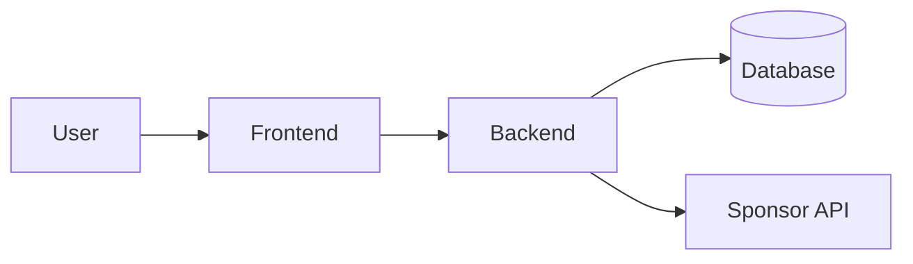

# Architecture

Keep this current. Update it when the design changes.

## One-line pitch
-

## Stack
- Frontend:
- Backend:
- Database / auth:
- Hosting:
- AI / APIs:

## Diagram
GitHub renders Mermaid. Edit this block.

## Who owns what
- Name: area
