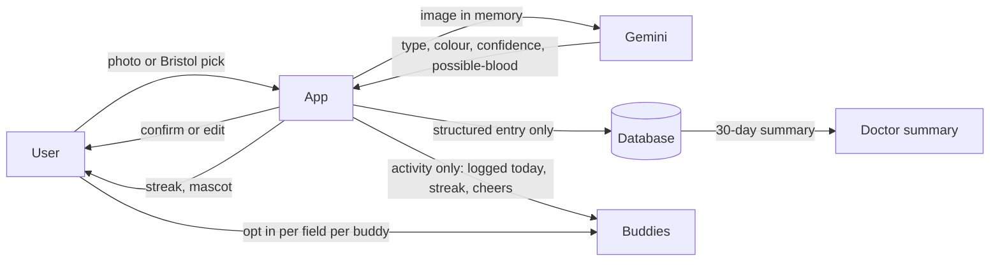

# Architecture

Keep this current. Update it when the design changes.

## One-line pitch
Log your poop in five seconds, let an AI read the photo, keep a streak with a few friends, and walk into the doctor's office with a record.

## Where this came from
This replaces Wave V2 (the user's call, 2026-11-07, see decisions.md). Photo scan, gamification and social tracking already exist in app stores (Dieta, PoopCheck, PoopMates, Unchikun). We chose to build anyway. Our edge is fun and polish, a privacy-first design (photos never stored, friends see activity and not health data), and an optional cycle layer. The pitch must not claim "first".

## Product
- **Core loop (never cut):** open the app, one big Log button, camera or "skip photo", the scan returns a Bristol type (1 to 7), colour, confidence and a "possible blood" flag, the user confirms or edits on one screen, the entry saves, the streak ticks, the mascot reacts. Target: five seconds.
- **Photo scan (never cut, with confirm and failure path):** Gemini vision with structured JSON output, called server-side. The photo is analysed in memory and discarded. Only the structured result is stored. Low confidence, a refusal or an error shows "Not sure, you pick" with the manual picker.
- **Blood wording (never cut):** the scan never says "no blood". It says "possible blood" or "can't tell from a photo". The user can set the flag by hand. Copy says this is not a diagnosis and to see a doctor about blood.
- **Quick log without photo (never cut):** an illustrated Bristol picker. The whole app works with no camera.
- **Gamification:** an original mascot of our own (not borrowed from any brand) that reacts to logging and grows through three stages. Streaks with a freeze. Small daily and weekly quests. Badges. Rule: reward logging, never outcomes. No ranking or points for any Bristol type, no shame copy for any type, a missed day is never punished.
- **Social, "buddies" (never cut, activity only):** invite by link, accept to join, a circle of about five. By default a buddy sees only: logged today, streak, mascot level, emoji cheers (three fixed). Photos, Bristol type, colour, blood flag and cycle data are never shared unless the user turns on a specific field for a specific buddy. Remove or leave takes effect immediately. Nobody is added without accepting.
- **Doctor summary (after the gate):** one page for the last 30 days: frequency, Bristol distribution, "possible blood" entries with dates, notes, a timeline. On-screen first, PDF is cuttable. Not a diagnosis.
- **Cycle layer (optional, off by default, after the gate, cut first):** a cycle-day field on the log and a chart overlaying bowel pattern, bloating and pain by cycle day. Not gendered: it is a toggle for anyone with a cycle. Never shared with buddies, deletable, minimum stored. Copy says patterns to discuss with a doctor, no claims.
- **Accessibility:** large targets, high contrast, no colour-only state, text for every illustration, a "plain words" setting that swaps cute names for clinical ones, reduced motion, full use without the camera.
- **Privacy:** delete-my-data button, no third-party analytics. Check the Gemini API data terms for the tier we use before the demo and say what we found.

## Honesty rules (say aloud and show on screen)
- Not a medical device. No diagnosis. Scan and summary screens say so.
- Scan accuracy on real stool is untested. For scale, a research smart toilet reached about 82 percent balanced accuracy on form and about 75 percent on blood. We claim no number of our own.
- The demo uses Play-Doh or illustrated samples, never real stool, and we say so.
- Similar apps exist. We do not say first.
- Research is desk-based from public sources, not interviews.
- The buddies in the demo are seeded and labelled.

## Prize
Open. Gemini is now core (the scan). Auth0 is login and invites. The rules allow one opt-in. Recommendation: Gemini (Senate run 8 agrees). Decide by about hour 3 and confirm timing with organizers. Until decided, rules.md still says Auth0.

## Stack (proposed, not confirmed)
- Frontend and backend: Next.js with TypeScript on Vercel (public URL so two phones can open it)
- Database: Supabase Postgres, DB only
- Scan: Gemini vision, structured output, server route, image held in memory only
- Auth: Auth0 passwordless login and invitations. If the prize pick moves to Gemini, a plain magic link is acceptable.
- Buddy updates: polling. No native push.
- Status: all TODO until the team confirms.

## Diagram

## Hour-8 gate (two real phones)
Login works. A buddy invite is accepted. A photo of a Play-Doh sample goes to Gemini and returns a type, the user confirms, the entry saves and the streak ticks. The buddy's phone shows "logged today". Quick log without a photo works. The scan failure path ("Not sure, you pick") works. If the scan fails the gate, the manual picker becomes the main path and the scan is a bonus.

## First-hour spike
Run Gemini vision on five test images (Play-Doh, illustrations). Check refusals, latency and JSON validity before building around it.

## Cut order, first to last
Cycle layer, group quests, mascot stages beyond three, doctor summary PDF (keep on-screen), emoji reactions beyond three, doctor summary on-screen.
Never cut: quick log, scan with confirm and failure path, streak with freeze, login, buddy invite and accept with activity-only sharing, photos not stored, the blood wording.

## Rubric map
- Problem Research: IBS prevalence, cycle-linked symptoms, diagnosis delay in young adults, the stigma of talking about it. Desk-based, see research.md.
- Technical: Gemini vision with structured output, auth and invitations, privacy-by-design data flow.
- Design: five-second log, mascot, plain-words mode, accessibility.
- Innovation: privacy-first social and the optional cycle layer. Not first, and we say so.
- Pitch: a memorable hook, an honest limits slide, a clear privacy answer.

## Pitch and demo safety (Senate run 8)
- Lead the pitch with the doctor summary and the privacy design (photo discarded, buddies see activity only, never "no blood"), not the stool.
- Scripted Q and A answer: "We log, we never diagnose. The possible-blood flag only prompts a doctor visit." Do not pitch cancer detection.
- User confirm-or-edit is the real product. Gemini only pre-fills. Keep the manual path.
- A cached known-good demo run sits behind a live/cached switch, so a stage network failure cannot stall the pitch. Pre-cache a good run before hour 8.
- Illustrated or Play-Doh samples only. Never cite the smart-toilet 82 and 75 percent figures as ours.
- The cycle layer is a roadmap slide unless everything else is done. Cite only the sourced facts (IBS about 12 percent in women vs 8.6 percent in men, endometriosis OR 3.26).

## Demo order
Open, tap Log, scan a Play-Doh sample, show the confidence and confirm, mascot reacts and streak ticks, the buddy's phone shows "Sam logged today" and a cheer, the privacy screen showing what buddies can and cannot see, the doctor summary, optionally the cycle overlay, then the honest limits slide.

## Who owns what
- Design lead (the user): mascot, log flow, screens, plain-words mode.
- Backend and data: Gemini route, database, auth, buddies.
- Research and pitch: sources, test images, privacy slide, the 4-minute pitch and Q and A.
